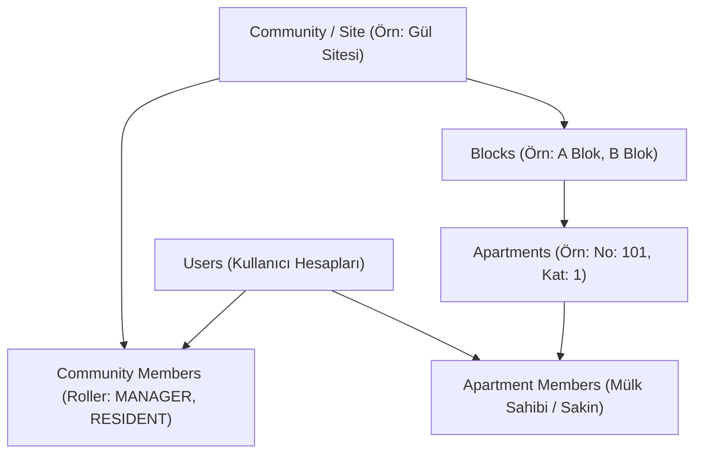

# RezidansPro — Mimari Tasarım Dokümanı (Architecture)

## 1. Ürün Vizyonu ve Temel İlkeler

**RezidansPro**, apartman, site, rezidans ve toplu konut kompleksleri için iletişim, duyuru, arıza bildirimi, toplantı, anket, aidat bilgilendirme ve yönetici-sakin etkileşimini tek bir çatı altında toplayan modern, güvenli ve kurumsal bir mobil yönetim platformudur.

### Temel Tasarım İlkeleri:
1. **Kesin Rol Ayrımı (Manager vs. Resident)**:
   - Yöneticiler apartman/site operasyonunu yönetirken, sakinler yalnızca kendi yaşam alanları ve genel bina duyuruları ile ilgilenir.
   - Rol kontrolü sadece arayüzde buton gizleyerek değil, backend katmanında her bir istek için yetkilendirme (`role-based authorization`) ile garanti altına alınır.
2. **Kritik Aidat Gizliliği (Dues Privacy Barrier)**:
   - Aidat borcu bilgisi topluluk seviyesinde asla herkese açık olamaz.
   - Bir sakinin aidat borcu veya ödeme geçmişi ana sayfada, duyurularda, komşular listesinde, bildirim başlıklarında veya kilit ekranı push bildirimlerinde görünemez.
   - Tutar yalnızca sakinin kendi doğrulanmış oturumunda ve yetkili bina yöneticisine özel yönetim panelinde görünür.
3. **Sosyal Medya Değil, Yönetim Aracı**:
   - Sakinler arası takip, beğeni, açık profil veya dedikoduya zemin hazırlayacak komşular arası açık sohbet odaları bulunmaz.
   - İletişim, sakin ile yetkili yönetici arasında 1-e-1 güvenli kanal üzerinden yürütülür.

---

## 2. Sistem Mimarisi Genel Bakış

```
+-------------------------------------------------------------------------+
|                           RezidansPro Mobile                            |
|                 (Flutter 3.x / Dart / Material 3 / Android)             |
|                                                                         |
|  [Auth/Splash]  [Resident Flow]  [Manager Flow]  [Shared Features]      |
|  Provider State Management  |  Secure Storage  |  REST API Client       |
+-------------------------------------------------------------------------+
                                    |
                            HTTPS / JSON REST
                                    |
+-------------------------------------------------------------------------+
|                           RezidansPro Backend                           |
|                       (Python 3.12+ / FastAPI)                          |
|                                                                         |
|   +-------------------+  +-------------------+  +-------------------+   |
|   |   API Routing     |  |   Auth & Security |  |  Business Logic   |   |
|   |  - Auth           |  |  - JWT Access/Ref |  |  - Roles/RBAC     |   |
|   |  - Communities    |  |  - Argon2 Hash    |  |  - Dues Isolation |   |
|   |  - Announcements  |  |  - Tenant Guards  |  |  - Fault Handling |   |
|   |  - Maintenance    |  |  - Play Compliance|  |  - Audit Logging  |   |
|   |  - Dues/Messages  |  +-------------------+  +-------------------+   |
+-------------------------------------------------------------------------+
                                    |
                        SQLAlchemy 2.0 Async/Sync
                                    |
+-------------------------------------------------------------------------+
|                            Veritabanı Katmanı                           |
|                     PostgreSQL (Dev: SQLite Destekli)                   |
|                        Alembic Migration Engine                         |
+-------------------------------------------------------------------------+
```

---

## 3. Katmanlı Mimari Detayları

### 3.1. Mobil Uygulama (Mobile - Flutter)
- **Framework**: Flutter 3.47+ & Dart 3.13+
- **Tasarım Dili**: Google Material 3 (`useMaterial3: true`), SaaS estetiği, yumuşak gölgeler (`elevation: 0-2`), 12-16px köşe yuvarlatmaları (`RoundedRectangleBorder`).
- **Durum Yönetimi (State Management)**: `Provider` & `ChangeNotifier`. Bağımsız provider'lar (`AuthProvider`, `CommunityProvider`, `AnnouncementProvider`, `MaintenanceProvider`, `DuesProvider`, vb.).
- **Ağ & Depolama**: `http` istemcisi, `SharedPreferences` (token ve kullanıcı oturum persistence), merkezi API servisi (`ApiService`).
- **Merkezi Konfigürasyon**:
  - `AppConfig`: Uygulama adı (`RezidansPro`), mağaza adı (`RezidansPro - Apartman & Site`), destek e-postası, web adresi.
  - `AppColors`: Kesin kurumsal renk paleti (`#2563EB` Primary, `#14B8A6` Secondary, `#0F172A` Dark, `#F8FAFC` Background, `#F59E0B` Warning, `#DC2626` Error, `#16A34A` Success).
  - `AppLocalizations`: Türkçe ve İngilizce çift dil desteği.

### 3.2. Sunucu Katmanı (Backend - FastAPI)
- **Framework**: FastAPI (Python 3.12+)
- **ORM**: SQLAlchemy 2.0 (Modern Type-Annotated `Mapped[T]`)
- **Şema Doğrulama**: Pydantic v2 (`ConfigDict(from_attributes=True)`)
- **Kimlik Doğrulama**: JWT (JSON Web Tokens) `HS256` şifreleme; Kısa süreli Access Token (120 dk) + Uzun süreli Refresh Token (30 gün).
- **Şifreleme**: `Argon2` / `passlib` ile endüstri standardı parola özetleme.
- **Migration**: Alembic tam şema sürümleme.

---

## 4. Çoklu Kiracılık (Multi-Tenancy) ve Organizasyon Modeli

Bir bina veya site yapısı hiyerarşik olarak modellenmiştir:



### Yetkilendirme Bağımlılıkları (FastAPI Dependencies):
- `get_current_user`: Authorization başlığındaki Bearer token'ı çözerek kullanıcıyı tespit eder.
- `verify_community_membership`: Kullanıcının hedef sitede aktif üye olduğunu doğrular.
- `require_manager_role`: Kullanıcının hedef sitede `MANAGER` veya `ASSISTANT_MANAGER` yetkisine sahip olduğunu teyit eder; aksi halde anında `HTTP 403 Forbidden` döndürür.
- `get_user_apartments`: Sakinin ilgili sitede ikamet ettiği veya sahibi olduğu daire kimliklerini listeler (Aidat ve arıza sorgularında güvenli filtreleme için kullanılır).

---

## 5. Güvenlik ve İzolasyon Mimarisi

### 5.1. Aidat İzolasyonu
- `GET /api/v1/dues/my`: Backend, kullanıcının `apartment_members` tablosunda kayıtlı dairelerini sorgular ve yalnızca bu dairelere ait aidat kayıtlarını döner. Sakin istek parametresiyle başkasının dairesini istese dahi backend sadece kendi dairelerini filtreler.
- `GET /api/v1/dues/manager`: Sadece `require_manager_role` bağımlılığından geçen yöneticilere açıktır.
- `POST /api/v1/dues/{id}/payments`: Sakin tek taraflı olarak aidatı ödendi yapamaz; tahsilat onayı ve makbuz kaydı sadece yönetici yetkisi ile gerçekleştirilir.

### 5.2. Mesajlaşma Duvarı
- Sakinler kendi aralarında mesajlaşamaz (`HTTP 403: Resident-to-resident messaging is not permitted`).
- Sakin sadece site yöneticisine mesaj atabilir; yönetici sakine yanıt verebilir.
- Sakinler yalnızca kendi dahil oldukları sohbet dizilerini görüntüleyebilir; başkasının mesaj ID'sine erişim denemesi `HTTP 403` ile engellenir.
