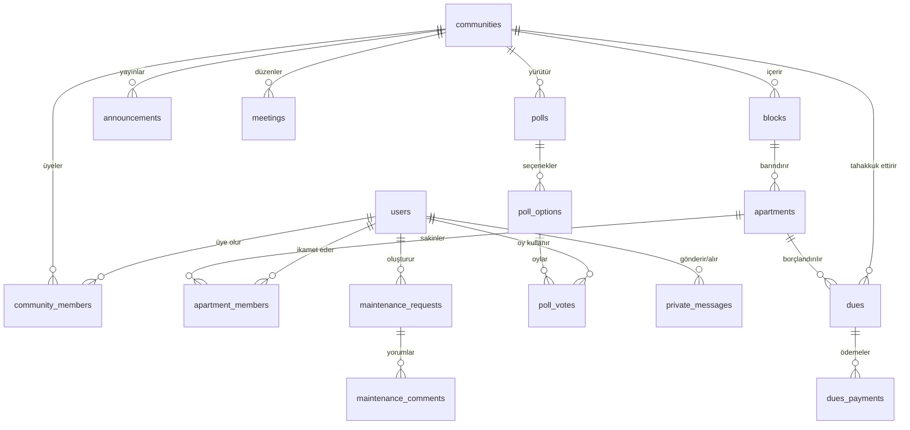

# RezidansPro — Veritabanı Şeması ve Veri Modeli (Database)

RezidansPro veritabanı, **PostgreSQL** üzerinde üretim ortamı için tasarlanmış olup geliştirme ve test ortamında **SQLite** ile tam uyumludur.  
ORM olarak **SQLAlchemy 2.0** (`Mapped[T]`), şema sürümleme ve migrasyon yönetimi için **Alembic** kullanılmaktadır.

---

## 1. Veritabanı Şeması Özeti (Entity Relationship)



---

## 2. Tablo Tanımları ve Kısıtlar (Constraints)

### 2.1. Kullanıcı & Topluluk Tabloları

#### `users`
Kullanıcı ana hesap tablosu.
| Kolon Adı | Tip | Kısıtlar | Açıklama |
|---|---|---|---|
| `id` | INTEGER | PK, Auto Increment | Benzersiz kimlik |
| `uuid` | VARCHAR(36) | UNIQUE, Indexed | Dış dünya UUID referansı |
| `email` | VARCHAR(255) | UNIQUE, Indexed, NOT NULL | Giriş e-posta adresi |
| `phone` | VARCHAR(32) | Nullable | Telefon numarası |
| `password_hash` | VARCHAR(255) | NOT NULL | Argon2 / bcrypt şifre özeti |
| `first_name` | VARCHAR(100) | NOT NULL | Adı |
| `last_name` | VARCHAR(100) | NOT NULL | Soyadı |
| `avatar_url` | VARCHAR(500) | Nullable | Profil resmi bağlantısı |
| `is_active` | BOOLEAN | Default: TRUE | Hesap aktiflik durumu |
| `created_at` | TIMESTAMP | Default: UTC NOW | Kayıt tarihi |
| `updated_at` | TIMESTAMP | Default: UTC NOW | Güncelleme tarihi |

#### `communities`
Bina, site veya rezidans organizasyon tablosu.
| Kolon Adı | Tip | Kısıtlar | Açıklama |
|---|---|---|---|
| `id` | INTEGER | PK | Site kimliği |
| `name` | VARCHAR(200) | NOT NULL | Örn: Gül Sitesi |
| `type` | VARCHAR(50) | NOT NULL | APARTMENT, SITE, RESIDENCE |
| `address` | VARCHAR(500) | NOT NULL | Açık adres |
| `city` | VARCHAR(100) | NOT NULL | Şehir (İstanbul, Ankara, vb.) |
| `district` | VARCHAR(100) | NOT NULL | İlçe |
| `created_at` | TIMESTAMP | Default: UTC NOW | Kuruluş tarihi |

#### `community_members`
Kullanıcının site içerisindeki üyelik ve yetki rolü.
| Kolon Adı | Tip | Kısıtlar | Açıklama |
|---|---|---|---|
| `id` | INTEGER | PK | Kayıt no |
| `community_id` | INTEGER | FK(communities.id) | Bağlı site |
| `user_id` | INTEGER | FK(users.id) | İlgili kullanıcı |
| `role` | VARCHAR(50) | NOT NULL | MANAGER, ASSISTANT_MANAGER, RESIDENT |
| `status` | VARCHAR(50) | Default: 'ACTIVE' | ACTIVE, PENDING, SUSPENDED |
| `joined_at` | TIMESTAMP | Default: UTC NOW | Katılma tarihi |
- **Kısıt**: `UNIQUE(community_id, user_id)`

#### `community_invite_codes`
Siteye katılmak için üretilen davet kodları tablosu.
- Kolonlar: `code` (UNIQUE), `community_id`, `role`, `expires_at`, `max_uses`, `used_count`.

---

### 2.2. Mimari Yapı: Bloklar ve Daireler

#### `blocks`
| Kolon Adı | Tip | Kısıtlar | Açıklama |
|---|---|---|---|
| `id` | INTEGER | PK | Blok no |
| `community_id` | INTEGER | FK(communities.id) | Bağlı olduğu site |
| `name` | VARCHAR(50) | NOT NULL | Örn: A Blok, B Blok |

#### `apartments`
| Kolon Adı | Tip | Kısıtlar | Açıklama |
|---|---|---|---|
| `id` | INTEGER | PK | Daire ID |
| `block_id` | INTEGER | FK(blocks.id) | Bağlı olduğu blok |
| `apartment_no` | VARCHAR(20) | NOT NULL | Kapı no (Örn: 101, 102) |
| `floor` | INTEGER | Nullable | Kat numarası |
| `type` | VARCHAR(50) | Nullable | 2+1, 3+1, Dubleks vb. |

#### `apartment_members`
Daireye atanmış sakin veya malikler tablosu.
- Kolonlar: `apartment_id` (FK), `user_id` (FK), `is_owner` (BOOLEAN), `is_primary_resident` (BOOLEAN), `joined_at`.
- **Kısıt**: `UNIQUE(apartment_id, user_id)`

---

### 2.3. Duyuru & Arıza Tabloları

#### `announcements`
| Kolon Adı | Tip | Kısıtlar | Açıklama |
|---|---|---|---|
| `id` | INTEGER | PK | Duyuru ID |
| `community_id` | INTEGER | FK(communities.id) | Hedef site |
| `author_id` | INTEGER | FK(users.id) | Oluşturan yönetici |
| `title` | VARCHAR(255) | NOT NULL | Başlık |
| `body` | TEXT | NOT NULL | İçerik metni |
| `priority` | VARCHAR(20) | Default: 'NORMAL' | NORMAL, IMPORTANT, URGENT |
| `published_at` | TIMESTAMP | Default: UTC NOW | Yayınlanma anı |
| `expires_at` | TIMESTAMP | Nullable | Yayından kalkış tarihi |

#### `maintenance_requests`
| Kolon Adı | Tip | Kısıtlar | Açıklama |
|---|---|---|---|
| `id` | INTEGER | PK | Arıza takip ID |
| `community_id` | INTEGER | FK(communities.id) | Site |
| `apartment_id` | INTEGER | FK(apartments.id), Nullable | İlgili daire (varsa) |
| `reported_by` | INTEGER | FK(users.id) | Bildiren sakin/yönetici |
| `category` | VARCHAR(50) | NOT NULL | ELEVATOR, WATER, ELECTRIC, vb. |
| `title` | VARCHAR(255) | NOT NULL | Başlık |
| `description` | TEXT | NOT NULL | Açıklama |
| `status` | VARCHAR(50) | Default: 'OPEN' | OPEN, IN_PROGRESS, WAITING, RESOLVED, CLOSED |
| `priority` | VARCHAR(20) | Default: 'MEDIUM' | LOW, MEDIUM, HIGH, CRITICAL |

---

### 2.4. Finans ve Aidat Tabloları [GİZLİLİK KRİTİK]

#### `dues`
Dairelere tahakkuk ettirilen periyodik aidat kayıtları.
| Kolon Adı | Tip | Kısıtlar | Açıklama |
|---|---|---|---|
| `id` | INTEGER | PK | Aidat ID |
| `community_id` | INTEGER | FK(communities.id), Indexed | Site |
| `apartment_id` | INTEGER | FK(apartments.id), Indexed | Tahakkuk eden daire |
| `period` | VARCHAR(50) | NOT NULL | Örn: 'Ekim 2026' |
| `amount` | NUMERIC(10, 2) | NOT NULL | Tutar (TL) |
| `due_date` | TIMESTAMP | NOT NULL | Son ödeme tarihi |
| `status` | VARCHAR(50) | Default: 'UNPAID' | UNPAID, PAID, OVERDUE, PARTIAL |

#### `dues_payments`
Yönetici tarafından işlenen tahsilat ve ödeme makbuzları.
- Kolonlar: `due_id` (FK), `amount`, `paid_at`, `payment_method` (BANK_TRANSFER, CREDIT_CARD, CASH), `reference`.

---

### 2.5. Toplantı, Anket ve Mesajlaşma Tabloları

#### `polls`, `poll_options`, `poll_votes`
- `poll_votes` üzerinde **`UNIQUE(poll_id, user_id)`** indeksi tanımlıdır. Böylece hiçbir sakin bir ankete birden fazla kez oy kullanamaz.

#### `private_messages`
Yönetici ve sakin arasında 1-e-1 şifreli/güvenli mesajlaşma tablosu.
- Kolonlar: `community_id`, `sender_id` (FK), `receiver_id` (FK), `subject`, `body`, `created_at`, `read_at`.

#### `audit_logs`
Sistemde gerçekleşen hassas işlemleri (aidat kaydı ekleme, üye silme, arıza durumu değiştirme) denetlemek üzere tutulan log tablosu.

---

## 3. Alembic Migrasyon Süreci

Migrasyon dosyaları `backend/alembic/versions/` altında versiyonlanmaktadır.

Yeni bir migrasyon oluşturmak için:
```bash
alembic revision --autogenerate -m "Add new feature columns"
```

Veritabanını en son sürüme güncellemek için:
```bash
alembic upgrade head
```
